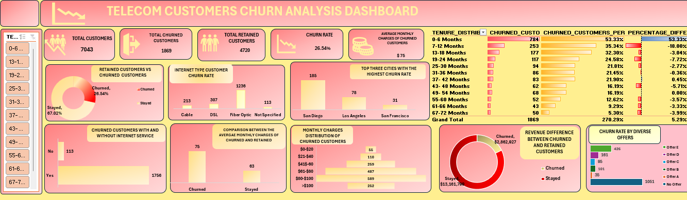

# Telecom-Customer-Churn-Analysis
**Customer Churn** is one of the most difficult situations facing telecommunication companies, losing customers over a long period of time affects the impacts revenue and long term profits.  The project with a use of data driven evidences contains investigation of factors affecting customer attrition and provides business insights. 
## Project Objective
- Investigate customers churn rate population
- Identify the demographic characteristics associated with churn
- Analyze possible factors that influenceschurning
- Examine the tenure of customers that churned
- Provision of insights and recommendations  
## Data Source 
The data set was primarily obtained from Kaggle, Kaggle is a popular data science platform that hosts publicly available datasets. 
## Tools Used 
- Power Query
- Python
- Microsoft Excel  
## Data Cleaning 
Upon data collection, the dataset was imported into **Power Query**, where an intensive check for duplicates, misspellings, missing values, data uniqueness/distinctiveness, and overall data quality, profile, and distribution was carried out.

The dataset was then migrated to **Python**, where the missing categorical values were filled with appropriate labels, while the numerical columns were imputed after a comparison between **Mean**, **Median**, **KNN**, and **MICE** imputation methods. The imputation technique with the lowest **Root Mean Square Error (RMSE)** was selected and applied.

Several visualization techniques, such as **histograms**, were utilized to understand the distribution of each numerical column, while **box plots** were used to detect outliers. Multiple outlier handling methods, including the **Interquartile Range (IQR)** and **percentile ranges**, were then applied where appropriate before the cleaned dataset was imported into **Microsoft Excel** for the analysis process.
## Exploratory Data Analysis
The analysis focused on identifying relationships between customer churn and:

- Age
- Gender
- Internet Type
- Comparison between customers that stayed and those that Churned 
- Monthly Charges
- Revenue
- Customer Tenure  
## Data Visualization 
<h3 align="center">📊 Featured Data Analytics Project</h3>

  

## Key Insights and Recommendation 
1.	**Overall churn rate**  
**Finding**  
-	Total Customers 7,043
-	Churned Customers 1,869 (26.54%)
-	Customers that stayed 4,720 (67.02%)  
**Insight** 
Analysis indicates that out of a total of 7,043 customers, 4,720 (67.02%) of the entire customer population stayed while 1,869 (26.54%) were observed to have churned. The remaining population consisted of customers that just joined, but this was overlooked as the analysis was solely focused on churned customers, the possible reasons behind their departures, and the impact it had on the organization. 

2.	**Age distribution analysis of churned customers** 
**Findings**  
- Young Adults (18-34 years), a total of 460 churned customers 
-	Middle Aged Adults (35-54 years), a total of 631 churned customers 
-	Older Customers (55-80 years), a total of 778 churned customers 
**Insight** 
It was observed within the analysis that customers considered as older adults (ages 55–80) recorded the highest churn count with a total of 778 customers, while younger adults (ages 18–34) had the lowest churn count at 460 customers. Most marketing strategies focused on younger adults could help improve customer retention. 
3.	**Gender Analysis**  
**Findings**  
-	Male, 930 churned 
-	Female 939 churned  
**Insight**   
  The difference in churn rate across both genders isn't significantly high and this indicates that gender isn't a strong factor influencing customer attrition.   

4.	**Internet Type Anlysis** 
**Findings**   
-	Fiber optic 1,236 total churned, $91 average monthly charges
-	DSL 307 total churned, $58 average monthly charges 
-	Cable 213 total churned, $60 monthly charges  
  **Insight**  
  Customers on fiber optics appeared to have churned the most and it was analyzed that this is the internet type with the most   expensive monthly charges. This may be an expression of dissatisfaction with pricing.  

5.	**MONTHLY CHARGES**  
**Findings**   
-	Customers within the charges range of $81-100 monthly churned the most at a count of 589 customers.
-	Customers within the charges range of $60-80 had the second highest churn count of 487 customers.  
 **Insight**  
 High charges having the highest number of churned customers is an indication of possible price sensitivity. A review of the pricing strategy and introduction of a more flexible billing process could help improve customer retention.   
6.	**Offer Analysis**   
**Findings**  
-	Customers with no offers that churned are about 1,051 in total  
  **Insight**  
  Offers appear to improve customers retention, especially offer A which was observed to have the least customer churn count. Customers who are not provided with promotional offers may feel less of a priority. Introducing a targeted diverse offer campaign could effectively reduce churning.   

7.	**Revenue Analysis**   
**Findings**   
-	Churned customers total revenue $2,862,927
-	Customers that stayed total revenue $13,161,799  
  **Insights**   
The revenue generated from customers who remained with the company is significantly higher than that of customers who churned, indicating a longer customer tenure and continued use of the company's services. This highlights the financial value of retaining long-term customers and the importance of implementing effective onboarding and retention strategies that encourage customers to build lasting relationships with the company.  

8.	**Tenure Analysis**   
**Findings**  
- Majority of customers that churned had a tenure of 0-6 months 784(53.33%)  
  **Insights**  
  Most churned customers tend to do so early indicating reluctance to develop a long Term loyalty to the company. A more long-term inclined onboarding process, provision of income friendly internet type and enticing Diverse offers should be deployed by the company.  
## Conclusion
The analysis identified key patterns associated with customer churn, including tenure, monthly charges, internet type, and revenue. The findings highlight the importance of improving customer retention strategies, especially during the early stages of the customer journey, while reviewing pricing and service offerings to reduce customer attrition.
  
